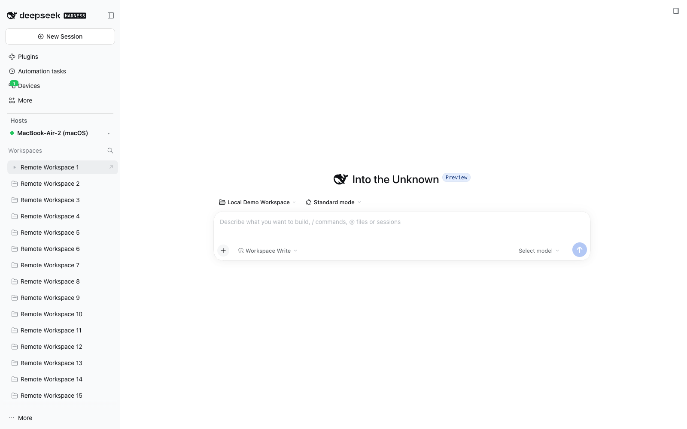
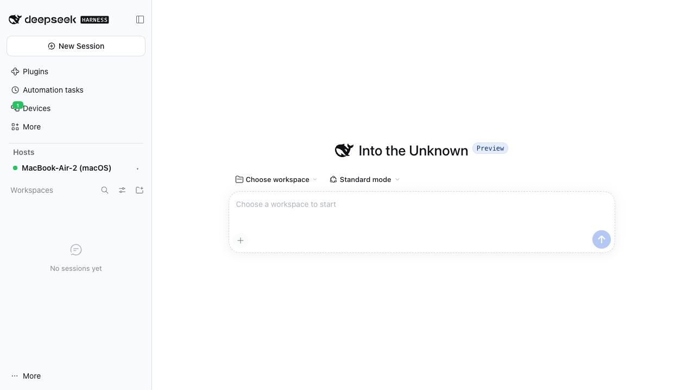

# DSH Device Mesh

[](https://github.com/kfxhjz/dsh-device-mesh/actions/workflows/ci.yml)
[](https://www.npmjs.com/package/dsh-device-mesh)
[](https://github.com/kfxhjz/dsh-device-mesh/releases)
[](https://github.com/kfxhjz/dsh-device-mesh/blob/main/LICENSE)
[](https://github.com/kfxhjz/dsh-device-mesh#requirements)

[简体中文](https://github.com/kfxhjz/dsh-device-mesh/blob/main/README.zh.md) | English

Pair multiple **DeepSeek Harness (DSH)** machines into one device mesh. After a
one-time pairing, any paired device can open another device's full DSH Web UI —
conversations, approvals, terminal, files and settings — as if you were sitting
in front of it.

> Status: developer preview (`v0.1.4`), targeting DSH `0.2.2-rc.2`.
> Design and security model: [docs/DESIGN.md](https://github.com/kfxhjz/dsh-device-mesh/blob/main/docs/DESIGN.md).
> Wire protocol: [docs/PROTOCOL.md](https://github.com/kfxhjz/dsh-device-mesh/blob/main/docs/PROTOCOL.md).

## What it is

DSH Device Mesh is a third-party DSH plugin (a host half plus a Web client half)
that connects separate DSH installations:

- The **daemon** is the device being controlled. It exposes a pairing ticket and
  accepts encrypted mesh sessions.
- The **controller** is the device you are sitting at. It pairs with a daemon,
  lists that device's workspaces, and opens its DSH Web UI through a local
  reverse proxy called a **portal**.

Roles are per connection, not per machine: every install ships both halves, so
each device can control others and be controlled. The protocol does not depend
on the operating system.

## Screenshots

The sidebar host switcher lists this host plus paired remotes; selecting a remote
mirrors its workspaces and sessions (marked **Remote**) while the local tree stays
intact, and any row opens the full remote UI through the portal.





Both screenshots come from the isolated two-instance E2E run, not from a real
device profile.

## Features

- **Symmetric by design** — one package, both roles. The same build runs on a
  Linux desktop, a Linux server and a macOS desktop.
- **Two transports, one session protocol** — direct WebSocket on the LAN or a
  Tailscale network, or a self-hosted [paseo-relay](https://github.com/kfxhjz/paseo-relay)
  over the public internet. The relay only forwards opaque ciphertext.
- **QR / link pairing** — the daemon shows a one-time QR code and a
  `dsh-mesh://pair?d=…` link. The controller scans it or pastes it.
- **Explicit local approval** — the daemon shows the controller's name, platform
  and a 6-digit SAS fingerprint (`123-456`) and waits for a human decision.
- **End-to-end encryption** — `Noise_NK_25519_ChaChaPoly_SHA256`, pinned device
  keys, one-time pairing tokens and per-device authorization.
- **Revocation and audit** — revoke any paired device at any time; pairing,
  connection, revocation and portal-open events are written to an audit log
  without message contents or secrets.
- **Local and remote are clearly separated** — a **host switcher above
  Workspaces** shows the current host; selecting a paired host replaces the
  workspace region with a remote mirror (host name, status, workspaces and
  sessions), and selecting this host restores the native local tree. The
  mirror has its own **View options** (group by workspace or one list, order by
  recent activity or title, hide/show/only archived), a **New session** (`+`)
  action on each remote workspace row, and per-session
  **Archive / Unarchive** actions, while the **Devices** panel remains the
  management surface for pairing and devices.
- **Compressed remote history** — large `/api/remote.mux` WebSocket messages
  (session history snapshots, streamed output) are gzipped end to end across the
  Mesh when both ends support it, so opening a large Session is not limited by
  transferring multi-megabyte JSON verbatim.

## Platform matrix

| Device | Form factor | Role | Direct | Relay | Verification |
|---|---|---|---|---|---|
| **A** | Linux desktop DSH | daemon + controller | ✅ | ✅ | Host + controller flow verified via `dsh web`; desktop UI pending |
| **B** | Linux server, `dsh web --no-open` | daemon + controller | ✅ | ✅ | Verified end to end via `dsh web` |
| **C** | macOS desktop DSH | daemon + controller | ✅ | ✅ | Verified via `dsh web`; Electron window/right-sidebar UI pending |
| **D** | Future official mobile DSH (Android / iOS / HarmonyOS) | controller (daemon later) | planned | planned | Not implemented |

Typical usage (a prime denotes a second device of the same class; any authorized
pairing works, including two devices of the same class):

- **A** controls **B** (Linux desktop ↔ Linux server).
- **B** controls **B′** (server ↔ second server).
- **C** controls **A**, **B** and **C′** (macOS desktop ↔ everything).
- A future **D** scans a pairing code and controls **A**, **B** and **C**.

The **D** row is intentionally conservative: the wire protocol and the client
half are platform-neutral, but no mobile build exists yet and camera /
background-lifecycle work has not been done. Android, iOS and HarmonyOS are
expected to load the same Web client half through the official DSH mobile shell
or a WebView host.

**Browser requirement for the controller:** the portal's cookie authentication
needs browser Fetch Metadata (`Sec-Fetch-Site`). Supported: Chromium 88+,
Firefox 90+, Safari 16.4+ and the Electron shell. Older browsers can still pair
and manage devices, but cannot open the remote UI; use a supported controller
browser instead.

## How it works

```text
Device A (daemon)                              Device B (controller)
┌─────────────────────────────────┐            ┌─────────────────────────────────┐
│ DSH host process                │            │ DSH host process                │
│                                 │            │                                 │
│  ┌───────────────────────────┐  │            │  ┌───────────────────────────┐  │
│  │ client plugin (Web UI)    │  │            │  │ browser: remote DSH UI    │  │
│  │  Devices / QR / workspaces│  │            │  │ (loopback portal URL)     │  │
│  └─────────────┬─────────────┘  │            │  └─────────────┬─────────────┘  │
│                │ same-origin    │            │                │ HTTP / WS      │
│  ┌─────────────▼─────────────┐  │            │  ┌─────────────▼─────────────┐  │
│  │ host plugin               │  │            │  │ host plugin               │  │
│  │  broker / direct / relay  │  │            │  │  controller / portal      │  │
│  └─────────────┬─────────────┘  │            │  └─────────────▲─────────────┘  │
└────────────────┼────────────────┘            └────────────────┼────────────────┘
                 │                                              │
                 └──────────── Noise NK (E2EE) ─────────────────┘
                        direct (LAN / Tailscale) or paseo-relay
```

1. **Identity.** On first start each device generates an Ed25519 signing key and
   an X25519 Diffie-Hellman key under `$DSH_HOME/device-mesh/identity.json`
   (mode `0600`). Public keys travel in pairing links; private keys never leave
   the device.
2. **Pairing.** The daemon creates a short-lived, signed ticket containing its
   public keys, reachable endpoints, a relay route only while this device serves
   relay, and a one-time token.
   The controller verifies the signature, pins the keys and connects. It proves
   possession of the token inside the encrypted channel; the daemon asks its
   local user, who compares the SAS with the controller.
3. **Transport.** Both sides then run the same Noise session over either a
   direct WebSocket (default port `45871`) or paseo-relay v2 (a control socket
   plus one data socket per controller). The relay cannot read or modify frames
   without detection.
4. **Remote control.** The controller starts a loopback portal. A browser tab
   loads the daemon's own DSH Web UI through the portal, and every HTTP request
   and WebSocket frame is proxied through the Noise session. The daemon's DSH
   browser cookie stays in the daemon's memory and never crosses the mesh.

## Requirements

- **DSH** `>=0.2.2-rc.1 <0.3.0` (declared in `package.json` → `engines.dsh`);
  CI and the release gate are pinned to `0.2.2-rc.2`. Incompatible DSH versions
  are rejected instead of silently degrading.
- **Node.js** `>=24.9.0` to build the plugin and to run server installs. The
  desktop app ships its own runtime.
- **npm** (the build uses only the dependencies in `package.json`).
- **pnpm** for `dsh plugin add`/`remove`: the DSH CLI forwards those commands to
  pnpm, so the desktop app's bundled CLI still needs a working pnpm on `PATH`.
  CI installs pnpm 11 and the pnpm major should track the DSH baseline.
- **macOS or Linux** for the tested matrix. Windows is not part of the tested
  matrix.
- **Optional:** a publicly reachable [paseo-relay](https://github.com/kfxhjz/paseo-relay)
  `v0.1.2` instance for internet-wide pairing. LAN and Tailscale do not need it.

## Install

The plugin is a standard DSH third-party bundle: a host plugin plus a Web client
plugin. Install the prebuilt package from npm without building anything:

```sh
dsh plugin --profile <profile> add dsh-device-mesh
```

The same command also accepts the `.tgz` from the
[latest release](https://github.com/kfxhjz/dsh-device-mesh/releases/latest)
(`add ./dsh-device-mesh-<version>.tgz`), which is the fallback while a specific
version is not on npm. The steps below build from source for contributors.

### Which profile?

`--profile` is required: it selects which DSH runtime composition receives the
plugin. A profile is a named, ordered stack of plugin-bundle patch layers under
`$DSH_HOME/profiles/<name>/`, with its own `package.json` (bundle list and
dependencies) and `cordis.patch.yml`. A bundle installed into one profile is not
visible to another, so install into the profile you actually boot:

| You start | Install into |
|---|---|
| DSH Desktop | `desktop` |
| `dsh web` | `web` |
| `dsh headless` | `headless` |
| `dsh tui` | `tui` |
| `dsh --profile <name>` (custom) | `<name>` |

```sh
# Desktop app
dsh plugin --profile desktop add dsh-device-mesh

# Headless server running `dsh web`
dsh plugin --profile web add dsh-device-mesh

# A custom profile created from the shipped web template
dsh --from-default-profile web --profile edge --dump-config
dsh plugin --profile edge add dsh-device-mesh
```

Inspect a profile without booting it:

```sh
dsh plugin --profile desktop list --depth 0   # installed packages
dsh --profile desktop --dump-config           # composed patch layers
```

`$DSH_HOME` defaults to `~/.dsh`; profile directories live under
`$DSH_HOME/profiles/`. `dsh plugin` without `--profile` fails, so always name the
profile you boot. The desktop app uses `desktop`; the CLI `dsh web` uses `web`.

### 1. Build from source

```sh
git clone <repo-url> dsh-device-mesh
cd dsh-device-mesh
npm install
npm run build        # produces lib/host/index.js and client.js
npm test             # optional: unit and transport suites
```

`npm run build` must finish before installing: DSH loads `lib/host/index.js`
and serves `client.js` from the package root.

### 2. macOS desktop (device C)

Use the `dsh` CLI bundled with the desktop app and install the checkout into the
reserved `desktop` profile:

```sh
"/Applications/DeepSeek Harness.app/Contents/Resources/runtime/cli/bin/dsh" \
  plugin --profile desktop add "$PWD"
```

If your app is installed elsewhere, substitute the equivalent bundled CLI path.
Quit and reopen DSH Desktop. The sidebar should now show a **Devices** entry (with an online-device
count); a **host switcher** sits in the sidebar directly above **Workspaces**, showing the current host name and, on click, paired remotes plus **Add host**, while the panel follows the selected host. **Add host**
(direct connection, remote SSH marked as planned, or paste a pairing link);
you can also confirm the plugin under **Settings → Plugins**.

### 3. Linux desktop (device A)

Use the `dsh` CLI shipped with your desktop build (on `PATH`, or under the app's
resources directory):

```sh
dsh plugin --profile desktop add "$PWD"
```

Restart the desktop app after the command succeeds.

### 4. Linux server, `dsh web --no-open` (device B)

```sh
dsh plugin --profile web add "$PWD"
dsh web --no-open
```

`dsh web --no-open` prints a tokenized loopback URL (`http://127.0.0.1:<port>/?token=…`).
Open it from a browser on the same machine, or keep the server headless and use
another device as the controller.

For access from other browsers, follow the DSH public-deployment guide: `--host`
must be a **concrete local address** (DSH rejects wildcard binds), and a
browser-visible authority must be declared with `--trusted-host`. Terminate TLS
at DSH or at a reverse proxy. Do not expose a plain `http://` DSH Web port to an
untrusted network.

### 5. Install from a `.tgz`

If you prefer a single artifact, pack the built directory and install that:

```sh
npm pack
dsh plugin --profile desktop add ./dsh-device-mesh-<version>.tgz
```

The same `add` command accepts a local directory, a `.tgz`, an npm package name
or a `link:` spec. Relative paths are resolved from the directory where you run
the command.

### 6. Mobile (device D, future)

There is no mobile app yet. The controller half is a Web client bundle, so once
an official DSH mobile shell or WebView host exists on Android, iOS or HarmonyOS
it can load the same UI. The protocol is platform-neutral; camera permission, QR
scanning and background keep-alive must be adapted separately.

### Upgrading

Rebuild, reinstall into the same profile and restart DSH:

```sh
npm run build
dsh plugin --profile <profile> add "$PWD"
```

Device identity and pairings live in `$DSH_HOME/device-mesh/` and are preserved.
An incompatible protocol version is rejected and requires re-pairing.

## Pairing and usage

The UI labels below are the English defaults; the plugin ships English and
Chinese dictionaries and follows the DSH language setting.

### Pair a controller with a daemon

1. **On the daemon:** open **Devices → This device → Create pairing link**. The
   panel shows a QR code and a `dsh-mesh://pair?d=…` link. It is valid for 10
   minutes and is removed the first time a controller presents it (before
   approval). If the request is denied or the prompt is lost, create a new link.
2. **On the controller:** open **Devices → Add remote device**, then **Scan**
   (Chromium's `BarcodeDetector`) or **Paste manually**.
3. **On the daemon:** a **Pairing request** appears with the controller's name,
   platform and a 6-digit security code, for example `123-456`. Compare it with
   the controller and click **Allow**.
4. **On the controller:** the device moves to **Paired devices** and its status
   becomes **Online**.

The security code is derived from the Noise handshake hash and both public keys.
If the two screens show different codes, deny the request. The controller waits
up to 5.5 minutes for approval; if its session closes first, the daemon denies
the pending request automatically.

### Open the remote control

- **Devices → Paired devices → Open remote control** opens the daemon's complete
  DSH Web UI. On the Web profile it renders in an iframe over the local center
  column (`http://127.0.0.1:<random port>/`), so the local sidebar stays usable
  and no remote credential reaches the browser. The same center-column surface
  is used in the Desktop shell: the portal cookie is `SameSite=None; Secure`, and
  the response is a bootstrap page that lets the cross-site `dsh-app:` iframe
  acquire it. The remote shell's own sidebars are collapsed and its Session is
  selected from `?dm-session=`, so it reads like the local conversation column.
  Right-sidebar Browser tab and the system browser remain fallbacks.
- The **host switcher above Workspaces** mirrors the selected daemon's
  workspaces and sessions (marked with a **Remote** badge); opening a row starts
  the same portal. A listing is capped at 200 sessions across at most 100
  workspaces so it fits one encrypted message, and says so when it was trimmed.
- GUI assets are content-addressed and cached under `$DSH_HOME/device-mesh/portal-cache`;
  reopening the same remote build skips the multi-megabyte plugin download.
- The portal is owner-level control of the peer. Anyone who can reach that
  browser tab can operate the remote DSH. Close the tab when you are done; an
  idle portal closes after 30 minutes by default.

### Direct or relay

- **Direct** is used first when the pairing ticket contains a reachable LAN or
  Tailscale address. The plugin listener defaults to TCP `45871`; allow it
  through the host firewall when direct connections are wanted.
- **Relay** is used when direct is disabled or unreachable. Both devices
  configure the same relay, the daemon connects outbound, and no inbound port is
  needed on the daemon.
- The pairing ticket records both routes when available; the controller picks
  one automatically. Disable **Direct listener** under **Devices → This device**
  on a public host to force relay-only operation.

## Public relay setup

A relay is optional. It is the recommended path when devices are not on the same
LAN or Tailscale network and you do not want to expose inbound ports.

Run the published relay image:

```sh
docker run -d --name paseo-relay --restart unless-stopped --stop-timeout 30 \
  --read-only --cap-drop ALL --security-opt no-new-privileges \
  -p 127.0.0.1:4000:4000 \
  -e PASEO_RELAY_MAX_CONNECTIONS=4000 -e PASEO_RELAY_MAX_SESSIONS=4000 \
  ghcr.io/kfxhjz/paseo-relay:v0.1.2
```

Then put TLS in front of it (Caddy or Nginx) and expose a `wss://` endpoint such
as `wss://relay.example.com/ws`. Keep the relay itself bound to loopback on the
host. Do not run a public relay over plain `ws://`.

On each device:

1. Open **Devices → This device → Public relay**.
2. Enter the relay URL or a bare IP/domain (optionally with a port); the plugin
   normalizes it to `wss://<host>/ws` and accepts a pasted `http(s)://` or
   `ws(s)://` URL (an explicit `wss://`/`https://` turns the TLS switch on, an
   explicit `ws://`/`http://` turns it off). If you only **control** other devices, leave **Allow relay control of this device** off: the endpoint is still used for outbound sessions, but starting a
second relay server slot on the same public relay can make both sides reconnect
in a loop. Enable it only when another device must reach this machine.

If the relay itself serves plain `ws://`
   (for example a bare paseo-relay without a TLS proxy), turn **Use TLS (wss)**
   off. That opt-in is for trusted/testing networks only; a public relay must
   terminate TLS in front of it.
3. Click **Save and enable**; the panel shows **Connected** when the outbound
   relay socket is up.
4. On a public host, also disable **Direct listener** so the pairing ticket is
   relay-only.

Operational notes:

- The relay routes by a random `serverId` that is part of the pairing ticket.
  Treat it as a secret and rotate it if a ticket leaks.
- Multi-node relays must hash consistently on the `serverId` query parameter,
  otherwise the two ends of a session land on different nodes.
- Expose `/health` and `/ready` for probes, not `/metrics`.
- Keep access logs free of query strings (`serverId`) and payloads.
- See the [paseo-relay documentation](https://github.com/kfxhjz/paseo-relay) for
  Compose/Caddy examples, drain behavior and capacity planning.

## Security summary

- **End-to-end encryption.** Every transport runs
  `Noise_NK_25519_ChaChaPoly_SHA256` with prologue `dsh-mesh/1`. The relay sees
  routing metadata (`serverId`, connection ids), frame sizes and timing, but not
  plaintext.
- **Pinned identities.** The daemon's Ed25519/X25519 public keys are distributed
  out of band in the pairing link and pinned by the controller. A changed key
  means a changed device: re-pair and verify the warning.
- **Portal isolation.** The portal binds loopback, requires the exact `Host`,
  checks same-origin browser requests (cookie-authenticated requests must carry
  `Sec-Fetch-Site`: `same-origin` or `none`) and the portal `Origin` on WebSocket
  upgrades, and strips the one-time capability token from forwarded requests.
- **Least privilege and revocation.** `view` grants are reserved and rejected by
  the current release; portal access requires an unrestricted `control` grant;
  revocation/expiry closes live sessions and portals (within the 30-second grant
  sweep).
- **The pairing code is control.** A pairing link is a one-time bearer credential
  valid for 10 minutes; its token is consumed on first presentation, before
  approval. Anyone who scans it can request control; the daemon still requires
  local approval and SAS comparison. Treat the QR code and link like a password,
  and never post a screenshot of them.
- **Loopback portal.** The controller-side portal binds to `127.0.0.1` on a
  random port and requires a 32-byte capability token exchanged for an
  `HttpOnly; SameSite=None; Secure` cookie. Loopback cookies are host-scoped, not
  port-scoped: another local web server you visit can read the cookie server-side,
  so treat local processes as partially trusted and close unused portal tabs.
  Never port-forward or reverse-proxy the portal. Cookie-authenticated portal
  requests require browser Fetch Metadata (`Sec-Fetch-Site`); browsers that do
  not send it cannot open the remote UI (Chromium/Electron on the supported
  matrix does).
- **Revocation and audit.** Each paired device can be revoked from the Devices
  panel; revocation disconnects the session and blocks future handshakes. Pairing,
  connection, revocation and portal-open events are audited without message
  contents, tokens or cookies.
- **Trusted host code.** A DSH host plugin runs as trusted Node.js code inside
  the DSH process. Installing this plugin is equivalent to running its code; only
  install builds you trust.
- **Not independently audited.** No third-party security audit has been
  performed yet; the release reflects an internal review with regression tests on
  pairing, Noise, portal authentication and revocation. Deploy it on devices you
  control, follow the hardening checklist, and report suspected issues privately.

Read [SECURITY.md](https://github.com/kfxhjz/dsh-device-mesh/blob/main/SECURITY.md) for the threat model, key handling and the
deployment hardening checklist. The architecture rationale is in
[docs/DESIGN.md §5](https://github.com/kfxhjz/dsh-device-mesh/blob/main/docs/DESIGN.md).

## Development

```sh
npm install
npm run build          # host + client
npm run build:host     # host bundle only
npm run build:client   # client bundle only (UI work)
npm run watch          # rebuild on change
npm run typecheck      # tsc --noEmit
npm test               # core + transport + host + client suites
npm run test:coverage  # the same suites with source coverage thresholds
npm run test:e2e       # two real `dsh web` instances (see below)
```

End-to-end tests need a DSH CLI:

- Set `DSH_CLI` to the `dsh` executable. Without it the harness tries the
  macOS packaged CLI, then `dsh` on `PATH`.
- The relay E2E case needs a local paseo-relay binary. Set `PASEO_RELAY_BIN`, or
  build one into `.build/`; if the binary is missing the case is skipped. Build
  hint: run
  `CARGO_TARGET_DIR=<path-to-this-repo>/.build/paseo-relay-target cargo build --release`
  in a paseo-relay checkout.
- `DSH_MESH_FORCE_BUILD=1` forces a rebuild before the tests run.
- E2E uses isolated `DSH_HOME` directories under `.test/e2e/`; your real
  `$DSH_HOME` is never touched.

Directory layout:

```text
src/shared/   wire types, transport and session interfaces (no Node dependencies)
src/host/     host plugin: Noise/channel/session, transports, store, pairing,
              workspaces, portals, DSH wiring
src/client/   Web client plugin: host switcher, sidebar workspace mirror, Devices panel, pairing QR
scripts/      build and development scripts
docs/         design, protocol, development guide and ADRs
test/         unit, transport and end-to-end suites
```

When changing UI or packaging, follow the plugin bundle contract described in
[CONTRIBUTING.md](https://github.com/kfxhjz/dsh-device-mesh/blob/main/CONTRIBUTING.md) and [docs/development.md](https://github.com/kfxhjz/dsh-device-mesh/blob/main/docs/development.md):
the client bundle must be wrapped in
`window.__ModuleLoader__.load({ id, factory })`, and React and the other DSH
baseline modules must stay external.

## Known limitations and roadmap

- **The MVP remote control is a portal.** It reverse-proxies the peer's complete
  DSH Web UI over the mesh. Remote workspaces are mirrored in the sidebar under
  Devices panel, but a **native workspace-row badge** needs an upstream
  `ui-workspace` slot (see [docs/DESIGN.md §8.3](https://github.com/kfxhjz/dsh-device-mesh/blob/main/docs/DESIGN.md#83-local-vs-remote-workspaces));
  DSH core is not modified in this MVP.
- **Native RPC control is Phase 2.** Driving remote sessions directly from the
  local UI (list sessions, send prompts, answer approvals, attach a terminal)
  is designed but not implemented. See
  [docs/development.md](https://github.com/kfxhjz/dsh-device-mesh/blob/main/docs/development.md) and
  [ADR 0001](https://github.com/kfxhjz/dsh-device-mesh/blob/main/docs/adr/0001-remote-control-in-dsh.md).
- **Desktop manual check.** The center-column iframe path is covered by the
  browser E2E suite; a final visual pass in the packaged Electron window is
  still recommended after install. Real-phone camera scanning has not been
  tested; there is no mobile (Android / iOS / HarmonyOS) build yet.
- **No file, clipboard or screen streaming.** No multi-hop/cascading, and no
  native Paseo protocol interop — only paseo-relay's routing is reused.
- **Version coupling.** DSH slot and service contracts can change between
  versions. The plugin is tested against `0.2.2-rc.2` and fails closed on an
  incompatible protocol version.
- **Windows** is not in the tested matrix.

## Docs

| Document | Contents |
|---|---|
| [README.zh.md](https://github.com/kfxhjz/dsh-device-mesh/blob/main/README.zh.md) | Chinese README (same structure as this file) |
| [docs/DESIGN.md](https://github.com/kfxhjz/dsh-device-mesh/blob/main/docs/DESIGN.md) · [中文](https://github.com/kfxhjz/dsh-device-mesh/blob/main/docs/zh/DESIGN.zh.md) | Architecture, security model, platform matrix, limitations |
| [docs/PROTOCOL.md](https://github.com/kfxhjz/dsh-device-mesh/blob/main/docs/PROTOCOL.md) · [中文](https://github.com/kfxhjz/dsh-device-mesh/blob/main/docs/zh/PROTOCOL.zh.md) | Wire protocol v1 |
| [docs/development.md](https://github.com/kfxhjz/dsh-device-mesh/blob/main/docs/development.md) · [中文](https://github.com/kfxhjz/dsh-device-mesh/blob/main/docs/zh/development.zh.md) | Maintainer guide: packaging, local loop, DSH integration, UI slots, testing, releases |
| [docs/adr/0001-remote-control-in-dsh.md](https://github.com/kfxhjz/dsh-device-mesh/blob/main/docs/adr/0001-remote-control-in-dsh.md) · [中文](https://github.com/kfxhjz/dsh-device-mesh/blob/main/docs/zh/adr/0001-remote-control-in-dsh.zh.md) | Architecture decision: host-side mesh plus loopback portal |
| [docs/README.md](https://github.com/kfxhjz/dsh-device-mesh/blob/main/docs/README.md) · [中文](https://github.com/kfxhjz/dsh-device-mesh/blob/main/docs/README.zh.md) | Documentation index |
| [CONTRIBUTING.md](https://github.com/kfxhjz/dsh-device-mesh/blob/main/CONTRIBUTING.md) · [中文](https://github.com/kfxhjz/dsh-device-mesh/blob/main/CONTRIBUTING.zh.md) | Development setup, packaging contract, PR rules |
| [SECURITY.md](https://github.com/kfxhjz/dsh-device-mesh/blob/main/SECURITY.md) · [中文](https://github.com/kfxhjz/dsh-device-mesh/blob/main/SECURITY.zh.md) | Vulnerability reporting and deployment hardening |
| [MAINTAINERS.md](https://github.com/kfxhjz/dsh-device-mesh/blob/main/MAINTAINERS.md) | Maintainers, review/release duties and the security triage route |
| [CODE_OF_CONDUCT.md](https://github.com/kfxhjz/dsh-device-mesh/blob/main/CODE_OF_CONDUCT.md) · [中文](https://github.com/kfxhjz/dsh-device-mesh/blob/main/CODE_OF_CONDUCT.zh.md) | Community behaviour expectations |
| [CHANGELOG.md](https://github.com/kfxhjz/dsh-device-mesh/blob/main/CHANGELOG.md) · [中文](https://github.com/kfxhjz/dsh-device-mesh/blob/main/CHANGELOG.zh.md) | Release history |
| [RELEASE.md](https://github.com/kfxhjz/dsh-device-mesh/blob/main/RELEASE.md) · [中文](https://github.com/kfxhjz/dsh-device-mesh/blob/main/RELEASE.zh.md) | Release gate: automated checks, manual matrix, known limitations |

## License

[MIT](https://github.com/kfxhjz/dsh-device-mesh/blob/main/LICENSE). [paseo-relay](https://github.com/kfxhjz/paseo-relay) is a
separate project and follows its own license.
