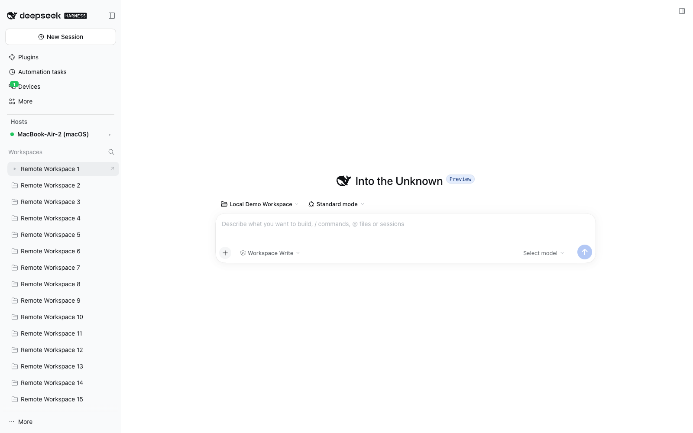
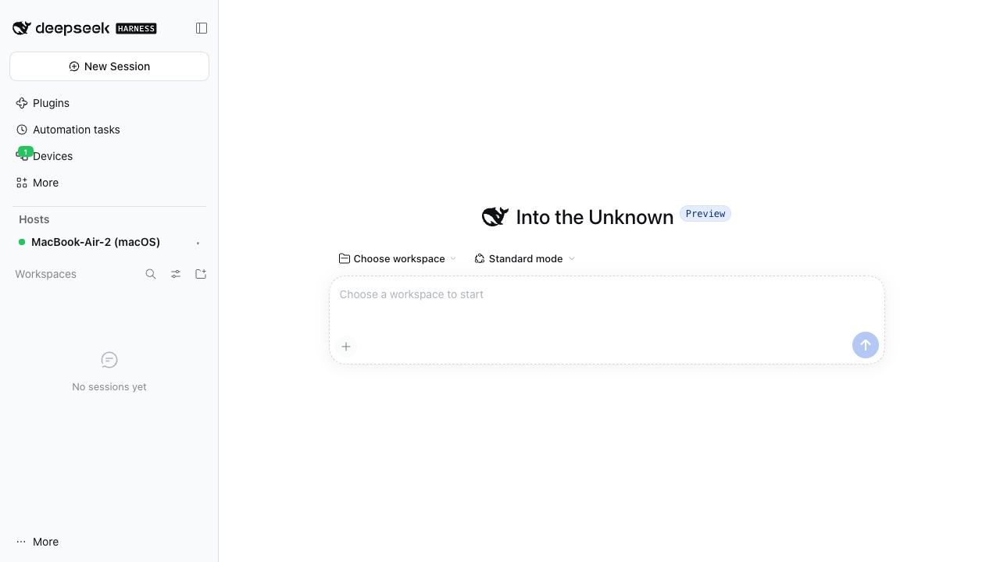

# DSH 设备网格

[](https://github.com/kfxhjz/dsh-device-mesh/actions/workflows/ci.yml)
[](https://www.npmjs.com/package/dsh-device-mesh)
[](https://github.com/kfxhjz/dsh-device-mesh/releases)
[](https://github.com/kfxhjz/dsh-device-mesh/blob/main/LICENSE)
[](https://github.com/kfxhjz/dsh-device-mesh#requirements)

[English](https://github.com/kfxhjz/dsh-device-mesh/blob/main/README.md) | 简体中文

把多台 **DeepSeek Harness (DSH)** 设备配成一个设备网格。配对一次之后，任意一台已配对设备都可以打开另一台设备的完整 DSH Web UI——对话、审批、终端、文件和设置——就像坐在那台机器前一样。

> 状态：开发者预览（`v0.1.3`），面向 DSH `0.2.2-rc.2`。
> 架构与安全模型：[docs/zh/DESIGN.zh.md](https://github.com/kfxhjz/dsh-device-mesh/blob/main/docs/zh/DESIGN.zh.md)。
> 线上协议：[docs/zh/PROTOCOL.zh.md](https://github.com/kfxhjz/dsh-device-mesh/blob/main/docs/zh/PROTOCOL.zh.md)。

## 这是什么

DSH 设备网格是一个第三方 DSH 插件（host 插件 + Web client 插件两半），用来连接相互独立的 DSH 安装：

- **被控端（daemon）**是被控制的那台设备。它生成配对凭证，并接受加密的网格会话。
- **主控端（controller）**是你正在使用的设备。它与被控端配对、列出对方的工作区，并通过一个名为 **portal（传送门）** 的本机反向代理打开对方的 DSH Web UI。

角色是按连接区分的，不是按机器固定的：每个安装都包含两半，所以每台设备既能控制别人，也能被控制。协议与操作系统无关。

## 界面截图

侧边栏的 host 切换器会列出本机与已配对远端；选择远端后，工作区区域会镜像对方的 workspaces 与 sessions（带 **Remote** 标记），本机目录树保持不变，任意一行都可以通过 portal 打开完整的远端 UI。





两张截图来自隔离的双实例 E2E 运行，不是真实设备 profile。

## 功能

- **天然对称**——一个包，两种角色。同一个构建可以跑在 Linux 桌面、Linux 服务端和 macOS 桌面。
- **两条传输，一套会话协议**——内网或 Tailscale 网络内使用直连 WebSocket；公网使用自建的 [paseo-relay](https://github.com/kfxhjz/paseo-relay)。中继只转发不透明密文。
- **二维码 / 链接配对**——被控端展示一次性二维码和 `dsh-mesh://pair?d=…` 链接，主控端扫码或粘贴。
- **显式本机确认**——被控端显示主控端名称、平台和 6 位 SAS 指纹（`123-456`），等待本机用户决定。
- **端到端加密**——`Noise_NK_25519_ChaChaPoly_SHA256`、钉扎设备公钥、一次性配对令牌、逐设备授权。
- **撤销与审计**——随时撤销任意已配对设备；配对、连接、撤销和 portal 打开事件会写入审计日志，不包含消息内容或密钥。
- **本地 / 远程清晰区分**——左栏「工作区」上方的**主机切换器**显示当前主机；选中已配对主机时，工作区区域切换为远程镜像（主机名、状态、工作区与会话），切回本机即恢复原生本地列表。镜像自带**视图选项**（按工作区/单列表分组、按最近更新/标题排序、隐藏/显示/仅显示已归档）和逐会话的**归档 / 取消归档**，**远程设备**面板继续负责配对与设备管理。
- **压缩远程历史**——portal 的 `/api/remote.mux` WebSocket 消息（会话历史快照、流式输出）在两端都支持时会在网格内端到端 gzip，打开大会话不再直接搬运多 MB 的明文 JSON。

## 设备矩阵

| 设备 | 形态 | 角色 | 直连 | 中继 | 验证情况 |
|---|---|---|---|---|---|
| **A** | Linux 桌面版 DSH | 被控 + 主控 | ✅ | ✅ | host 与主控流程已用 `dsh web` 验证；桌面 UI 待确认 |
| **B** | Linux 服务端，`dsh web --no-open` | 被控 + 主控 | ✅ | ✅ | 已用 `dsh web` 端到端验证 |
| **C** | macOS 桌面版 DSH | 被控 + 主控 | ✅ | ✅ | 已用 `dsh web` 验证；Electron 窗口 / 右侧栏 UI 待确认 |
| **D** | 未来官方移动版 DSH（Android / iOS / 鸿蒙） | 主控（后续可做被控） | 计划中 | 计划中 | 尚未实现 |

典型用法（带撇号的设备表示同类中的第二台；任意已授权方向都支持，包括同类设备之间）：

- **A** 控制 **B**（Linux 桌面 ↔ Linux 服务端）。
- **B** 控制 **B′**（服务端 ↔ 第二台服务端）。
- **C** 控制 **A**、**B** 和 **C′**（macOS 桌面 ↔ 其他设备）。
- 未来的 **D** 扫码后控制 **A**、**B**、**C**。

**D** 一行刻意保守：线上协议与 client 半边是平台无关的，但目前没有移动端构建，相机权限与后台保活也尚未适配。Android、iOS 与鸿蒙预计都能通过官方 DSH 移动外壳或 WebView 宿主加载同一套 Web client。

**主控端浏览器要求：** portal 的 cookie 认证需要浏览器提供 Fetch Metadata
（`Sec-Fetch-Site`）。支持 Chromium 88+、Firefox 90+、Safari 16.4+ 以及 Electron
外壳。更旧的浏览器仍可配对和管理设备，但无法打开远程 UI，请改用受支持的主控端浏览器。

## 工作原理

```text
Device A (daemon)                              Device B (controller)
┌─────────────────────────────────┐            ┌─────────────────────────────────┐
│ DSH host process                │            │ DSH host process                │
│                                 │            │                                 │
│  ┌───────────────────────────┐  │            │  ┌───────────────────────────┐  │
│  │ client plugin (Web UI)    │  │            │  │ browser: remote DSH UI    │  │
│  │  Devices / QR / workspaces│  │            │  │ (loopback portal URL)     │  │
│  └─────────────┬─────────────┘  │            │  └─────────────┬─────────────┘  │
│                │ same-origin    │            │                │ HTTP / WS      │
│  ┌─────────────▼─────────────┐  │            │  ┌─────────────▼─────────────┐  │
│  │ host plugin               │  │            │  │ host plugin               │  │
│  │  broker / direct / relay  │  │            │  │  controller / portal      │  │
│  └─────────────┬─────────────┘  │            │  └─────────────▲─────────────┘  │
└────────────────┼────────────────┘            └────────────────┼────────────────┘
                 │                                              │
                 └──────────── Noise NK (E2EE) ─────────────────┘
                        direct (LAN / Tailscale) or paseo-relay
```

1. **身份。** 每台设备首次启动时在 `$DSH_HOME/device-mesh/identity.json`（权限 `0600`）下生成 Ed25519 签名密钥和 X25519 Diffie-Hellman 密钥。公钥随配对链接分发；私钥永不离开设备。
2. **配对。** 被控端生成短期、带签名的配对凭证，包含公钥、可达端点、一次性令牌，以及仅在本机开启 relay 服务时才有的中继路由。主控端验证签名、钉扎公钥并连接，在加密通道内证明自己持有令牌；被控端请求本机用户确认，用户与主控端比对 SAS。
3. **传输。** 双方随后在直连 WebSocket（默认端口 `45871`）或 paseo-relay v2（一条 control socket，每个主控端一条 data socket）上运行同一套 Noise 会话。中继无法在未被发现的情况下读取或修改帧。
4. **远程控制。** 主控端启动一个回环 portal。浏览器标签页通过 portal 加载被控端自己的 DSH Web UI，所有 HTTP 请求和 WebSocket 帧都经 Noise 会话代理。被控端的 DSH 浏览器 cookie 只留在被控端内存中，不跨越网格。

## 环境要求

- **DSH** `>=0.2.2-rc.1 <0.3.0`（在 `package.json` 的 `engines.dsh` 中声明）；CI 与发布门禁固定在 `0.2.2-rc.2`。不兼容的 DSH 版本会被拒绝，而不是静默降级。
- **Node.js** `>=24.9.0`，用于构建插件和运行服务端安装。桌面版自带运行时。
- **npm**（构建只使用 `package.json` 中声明的依赖）。
- **pnpm**，用于 `dsh plugin add`/`remove`：DSH CLI 会把这两个命令转发给 pnpm，所以
  桌面版自带的 CLI 仍然需要 `PATH` 上有可用的 pnpm。CI 会安装 pnpm 11，pnpm 主版本
  应与 DSH 基线保持一致。
- **macOS 或 Linux** 属于已测试矩阵。Windows 不在测试矩阵内。
- **可选：** 一个公网可达的 [paseo-relay](https://github.com/kfxhjz/paseo-relay) `v0.1.2` 实例，用于跨公网配对。内网和 Tailscale 不需要。

## 安装

插件是标准的 DSH 第三方 bundle：一个 host 插件加一个 Web client 插件。多数用户可以直接
从 npm 安装预构建包，无需自己构建：

```sh
dsh plugin --profile <profile> add dsh-device-mesh
```

同一条命令也接受
[最新 release](https://github.com/kfxhjz/dsh-device-mesh/releases/latest) 里的预构建 `.tgz`
（`add ./dsh-device-mesh-<version>.tgz`），用于某个版本还没上 npm 时兜底。下面的步骤面向贡献者，从源码构建。

### `--profile` 是什么？

`--profile` 是必填的：它决定插件装进哪一套 DSH 运行时组合。profile 是
`$DSH_HOME/profiles/<name>/` 下按顺序叠加插件 bundle patch 层的一套环境，拥有自己的
`package.json`（bundle 列表与依赖）和 `cordis.patch.yml`。装进一个 profile 的 bundle
不会出现在另一个 profile 中，所以要装进你实际启动的那个：

| 你的启动方式 | 安装到 |
|---|---|
| DSH Desktop 桌面版 | `desktop` |
| `dsh web` | `web` |
| `dsh headless` | `headless` |
| `dsh tui` | `tui` |
| `dsh --profile <name>`（自定义） | `<name>` |

```sh
# 桌面版
dsh plugin --profile desktop add dsh-device-mesh

# 运行 `dsh web` 的无头服务器
dsh plugin --profile web add dsh-device-mesh

# 基于随附 web 模板创建的自定义 profile
dsh --from-default-profile web --profile edge --dump-config
dsh plugin --profile edge add dsh-device-mesh
```

不启动也能检查 profile：

```sh
dsh plugin --profile desktop list --depth 0   # 已安装的包
dsh --profile desktop --dump-config           # 组合后的 patch 层
```

`$DSH_HOME` 默认是 `~/.dsh`，profile 目录在 `$DSH_HOME/profiles/` 下。不带 `--profile`
的 `dsh plugin` 会直接报错，所以始终写清楚要启动的 profile。桌面版用 `desktop`；CLI 的
`dsh web` 用 `web`。

### 1. 从源码构建

```sh
git clone <repo-url> dsh-device-mesh
cd dsh-device-mesh
npm install
npm run build        # 产出 lib/host/index.js 与 client.js
npm test             # 可选：单元与传输测试
```

安装前必须完成 `npm run build`：DSH 会加载 `lib/host/index.js`，并从包根提供 `client.js`。

### 2. macOS 桌面版（设备 C）

使用桌面版自带的 `dsh` CLI，把当前目录装进保留的 `desktop` profile：

```sh
"/Applications/DeepSeek Harness.app/Contents/Resources/runtime/cli/bin/dsh" \
  plugin --profile desktop add "$PWD"
```

如果应用安装在别的位置，请换成对应的内置 CLI 路径。退出并重新打开 DSH 桌面版。左栏应出现**远程设备**入口（带在线设备数）；左栏「工作区」上方会出现**主机**切换器，直接显示当前主机名（默认本机），点击可切到已配对主机并有**添加主机**（直接连接、远程 SSH（计划中）、粘贴配对链接），面板跟随所选主机；也可以在**设置 → 插件**里确认插件已加载。

### 3. Linux 桌面版（设备 A）

使用桌面版自带的 `dsh` CLI（在 `PATH` 上，或位于应用的 resources 目录）：

```sh
dsh plugin --profile desktop add "$PWD"
```

命令成功后重启桌面版。

### 4. Linux 服务端，`dsh web --no-open`（设备 B）

```sh
dsh plugin --profile web add "$PWD"
dsh web --no-open
```

`dsh web --no-open` 会打印一个带令牌的回环地址（`http://127.0.0.1:<port>/?token=…`）。可以在同一台机器的浏览器里打开，也可以让服务端保持无头，用另一台设备作为主控端。

如果需要从其他浏览器访问，请遵循 DSH 的公网部署指南：`--host` 必须是**具体的本机地址**（DSH 拒绝通配地址），浏览器可见的 authority 必须用 `--trusted-host` 声明。TLS 可以终止在 DSH，也可以终止在反向代理。不要把明文 `http://` 的 DSH Web 端口暴露到不可信网络。

### 5. 从 `.tgz` 安装

如果希望使用单一产物，可以先打包构建目录再安装：

```sh
npm pack
dsh plugin --profile desktop add ./dsh-device-mesh-<version>.tgz
```

同一个 `add` 命令也接受本地目录、`.tgz`、npm 包名或 `link:` 规格。相对路径以运行命令时的目录为基准。

### 6. 移动端（设备 D，未来）

目前没有移动端应用。主控端是 Web client bundle，因此一旦 Android、iOS 或鸿蒙上出现官方 DSH 移动外壳或 WebView 宿主，就可以加载同一套 UI。协议与平台无关；相机权限、二维码扫描和后台保活需要单独适配。

### 升级

重新构建、装回同一个 profile，然后重启 DSH：

```sh
npm run build
dsh plugin --profile <profile> add "$PWD"
```

设备身份和配对记录保存在 `$DSH_HOME/device-mesh/`，升级后会保留。不兼容的协议版本会被拒绝，需要重新配对。

## 配对与使用

下面的 UI 名称以中文默认为准；插件同时提供中文和英文字典，并跟随 DSH 的语言设置。

### 把主控端与被控端配对

1. **在被控端：** 打开**远程设备 → 本机 → 生成配对链接**。面板会显示二维码和 `dsh-mesh://pair?d=…` 链接。链接 10 分钟内有效；主控端首次出示链接时令牌即被消费（发生在批准之前）。如果请求被拒绝或弹窗丢失，请重新生成链接。
2. **在主控端：** 打开**远程设备 → 添加远程设备**，然后点**扫一扫**（Chromium 的 `BarcodeDetector`）或**手动粘贴**。
3. **在被控端：** 出现**待批准的配对请求**，显示主控端名称、平台和 6 位安全码，例如 `123-456`。与主控端核对后点**允许**。
4. **在主控端：** 设备出现在**已配对设备**中，状态变为**在线**。

安全码由 Noise 握手哈希和双方公钥推导。如果两块屏幕显示的安全码不同，请拒绝该请求。主控端最多等待约 5.5 分钟；如果主控端会话先关闭，被控端会自动拒绝该待批准请求。

### 打开远程控制

- **远程设备 → 已配对设备 → 打开远程控制**会打开被控端完整的 DSH Web UI。Web 版在本地中间栏上方以 iframe 呈现（由回环 portal `http://127.0.0.1:<随机端口>/` 提供），本地左栏仍可使用，浏览器不持有远端凭据；桌面版同样是中间栏 iframe，portal cookie 使用 `SameSite=None; Secure`，由同源 bootstrap 页面完成跨站 cookie 获取。
- **左栏「工作区」上方的 host 切换器**会镜像所选被控端的工作区和会话，并带**远程**徽标；点开任意一项会启动同一个 portal。列表最多包含 100 个工作区、200 个会话，超出时会显示截断提示。
- portal 是对被控端的 owner 级控制。任何能访问该浏览器标签页的人都能操作远端 DSH。用完请关闭标签页；portal 默认在空闲 30 分钟后关闭。

### 直连还是中继

- 当配对凭证里包含可达的内网或 Tailscale 地址时，优先使用**直连**。插件监听默认使用 TCP `45871`；需要直连时请在主机防火墙上放行。
- 当直连被关闭或不可达时使用**中继**。两端配置同一个 relay，被控端主动出站，不需要在 daemon 上开放任何入站端口。
- 配对凭证会同时记录可用路由，主控端自动选择。在公网主机上，可以在**远程设备 → 本机**里关闭**直连监听**，强制只走中继。

## 公网中继配置

中继是可选的。当设备不在同一内网或 Tailscale 网络、又不希望暴露入站端口时，推荐使用中继。

运行已发布的 relay 镜像：

```sh
docker run -d --name paseo-relay --restart unless-stopped --stop-timeout 30 \
  --read-only --cap-drop ALL --security-opt no-new-privileges \
  -p 127.0.0.1:4000:4000 \
  -e PASEO_RELAY_MAX_CONNECTIONS=4000 -e PASEO_RELAY_MAX_SESSIONS=4000 \
  ghcr.io/kfxhjz/paseo-relay:v0.1.2
```

然后在它前面加 TLS（Caddy 或 Nginx），对外暴露 `wss://relay.example.com/ws` 这样的地址。relay 本身保持绑定在主机回环地址上。不要在公网上运行明文 `ws://` 中继。

在每台设备上：

1. 打开**远程设备 → 本机 → 公网中继**。
2. 填中继 URL，或只填 IP/域名（可带端口）；插件会规范化为 `wss://<host>/ws`，也接受粘贴完整的 `http(s)://` 或 `ws(s)://` 地址（显式 `wss://`/`https://` 会打开 TLS 开关，显式 `ws://`/`http://` 会关闭它）。
   如果中继本身只提供明文 `ws://`（例如 paseo-relay 前面没有 TLS 代理），
   请关闭「使用 TLS（wss）」开关。该选项仅用于可信/测试网络；公网中继必须在
   前面终止 TLS。
3. 点**保存并启用**；出站 relay 连接建立后，面板显示**已连接**。
4. 在公网主机上同时关闭**直连监听**，让配对凭证只包含 relay 路由。

运维注意事项：

- relay 按配对凭证里的随机 `serverId` 路由。把它当作秘密；凭证泄露后应轮换。
- 多节点 relay 必须按 `serverId` 查询参数做一致性哈希，否则同一会话的两端会落到不同节点。
- 对外提供 `/health` 和 `/ready` 供探针使用，不要暴露 `/metrics`。
- 访问日志不要记录查询串（`serverId`）和 payload。
- Compose/Caddy 示例、drain 行为和容量规划见 [paseo-relay 文档](https://github.com/kfxhjz/paseo-relay)。

## 安全说明

- **端到端加密。** 所有传输都运行 `Noise_NK_25519_ChaChaPoly_SHA256`，prologue 为 `dsh-mesh/1`。中继能看到路由元数据（`serverId`、connection id）、帧大小和时序，但看不到明文。
- **身份钉扎。** 被控端的 Ed25519/X25519 公钥通过配对链接带外分发，并由主控端钉扎。公钥变化即意味着设备变化：请重新配对并核对告警。
- **配对码就是控制权。** 配对链接是 10 分钟有效的一次性 bearer 凭据；主控端首次出示时令牌即被消费（发生在批准之前）。任何扫到它的人都可以请求控制；被控端仍要求本机确认并比对 SAS。请像对待密码一样对待二维码和链接，不要截图外发。
- **回环 portal。** 主控端 portal 只绑定 `127.0.0.1` 的随机端口，并要求用 32 字节能力令牌换取 `HttpOnly; SameSite=None; Secure` cookie。portal 会校验精确 `Host`、同源浏览器请求（带 cookie 的请求必须提供 `Sec-Fetch-Site`：`same-origin` 或 `none`）与 WebSocket 升级的 `Origin`，并从转发请求中剥离能力令牌；不要把 portal 端口转发或反向代理出去。带 cookie 的 portal 请求要求浏览器提供 Fetch Metadata（`Sec-Fetch-Site`）；不发送该头的浏览器无法打开远程 UI。注意回环 cookie 按 host 共享、不按端口隔离：你访问的其他本机 Web 服务可能读到该 cookie，请把本机进程视为部分可信，并及时关闭不用的 portal 标签页。
- **最小权限与撤销。** 当前版本保留但不接受 `view` 授权（审批时直接拒绝）；portal 需要不受限的 `control` 授权；撤销会立即断开会话与 portal，授权过期会在 30 秒清扫周期内生效。
- **撤销与审计。** 可以在远程设备面板撤销任意已配对设备；撤销会立即断开会话并拒绝后续握手。配对、连接、撤销和 portal 打开事件都会审计，但不记录消息内容、令牌或 cookie。
- **受信任的 host 代码。** DSH host 插件以受信任的 Node.js 代码运行在 DSH 进程内。安装本插件等同于运行它的代码；只安装你信任的构建。
- **尚未独立审计。** 目前没有经过第三方安全审计；本版本基于内部评审，配对、Noise、portal 认证与撤销路径都有回归测试。请只部署在你控制的设备上，按加固清单操作，并通过私密渠道报告可疑问题。

威胁模型、密钥处理和部署加固清单见 [SECURITY.zh.md](https://github.com/kfxhjz/dsh-device-mesh/blob/main/SECURITY.zh.md)。架构取舍见 [docs/zh/DESIGN.zh.md §5](https://github.com/kfxhjz/dsh-device-mesh/blob/main/docs/zh/DESIGN.zh.md)。

## 开发

```sh
npm install
npm run build          # host + client
npm run build:host     # 只构建 host
npm run build:client   # 只构建 client（改 UI 时）
npm run watch          # 变更时重建
npm run typecheck      # tsc --noEmit
npm test               # core + transport + host + client
npm run test:coverage  # 同一套测试 + 源码覆盖率门槛
npm run test:e2e       # 两个真实 `dsh web` 实例（见下）
```

端到端测试需要 DSH CLI：

- 设置 `DSH_CLI` 指向 `dsh` 可执行文件。未设置时，测试框架先找 macOS 打包应用里的 CLI，再找 `PATH` 上的 `dsh`。
- relay E2E 用例需要本地 paseo-relay 二进制。设置 `PASEO_RELAY_BIN`，或把二进制构建到 `.build/` 下；缺失时该用例会跳过。构建提示：在 paseo-relay checkout 中运行
  `CARGO_TARGET_DIR=<path-to-this-repo>/.build/paseo-relay-target cargo build --release`。
- `DSH_MESH_FORCE_BUILD=1` 会在测试前强制重新构建。
- E2E 使用 `.test/e2e/` 下的隔离 `DSH_HOME`，不会碰真实的 `$DSH_HOME`。

目录结构：

```text
src/shared/   线上协议类型、传输与会话接口（无 Node 依赖）
src/host/     host 插件：Noise/通道/会话、传输、存储、配对、工作区、portal、DSH 装配
src/client/   Web client 插件：主机切换器、侧栏工作区镜像、设备面板、配对二维码
scripts/      构建与开发脚本
docs/         设计、协议、开发指南与 ADR
test/         单元、传输与端到端测试
```

修改 UI 或打包方式时，请遵循 [CONTRIBUTING.zh.md](https://github.com/kfxhjz/dsh-device-mesh/blob/main/CONTRIBUTING.zh.md) 与 [docs/zh/development.zh.md](https://github.com/kfxhjz/dsh-device-mesh/blob/main/docs/zh/development.zh.md) 里的插件 bundle 契约：client bundle 必须包在 `window.__ModuleLoader__.load({ id, factory })` 里，React 等 DSH 基线模块必须保持 external。

## 已知限制与路线图

- **MVP 的远程控制是一个 portal。** 它把被控端完整的 DSH Web UI 经网格反向代理过来。远程工作区已镜像在左栏主机切换器下，但**原生工作区行徽标**需要 DSH 上游 `ui-workspace` 增加一个 slot（见 [docs/zh/DESIGN.zh.md §8.3](https://github.com/kfxhjz/dsh-device-mesh/blob/main/docs/zh/DESIGN.zh.md#83-本地--远程工作区)）；本 MVP 不修改 DSH 核心。
- **原生 RPC 控制是第二阶段。** 在本地 UI 内直接驱动远端会话（列会话、发 prompt、处理审批、attach 终端）已有设计但尚未实现。见 [docs/zh/development.zh.md](https://github.com/kfxhjz/dsh-device-mesh/blob/main/docs/zh/development.zh.md) 与 [ADR 0001](https://github.com/kfxhjz/dsh-device-mesh/blob/main/docs/zh/adr/0001-remote-control-in-dsh.zh.md)。
- **未验证的 UI 路径。** 桌面 Electron 中「新窗口打开 portal / 右侧栏打开」需要安装后人工目视确认。真机摄像头扫码尚未测试；目前没有移动端（Android / iOS / 鸿蒙）构建。
- **不做文件、剪贴板或屏幕串流。** 不做多跳/级联，也不与 Paseo 原生协议互通——只复用 paseo-relay 的路由。
- **版本耦合。** DSH 的 slot 与服务契约可能随版本变化。插件以 `0.2.2-rc.2` 为基线测试，遇到不兼容的协议版本会失败关闭。
- **Windows** 不在测试矩阵内。

## 文档

| 文档 | 内容 |
|---|---|
| [README.zh.md](https://github.com/kfxhjz/dsh-device-mesh/blob/main/README.zh.md) | 中文 README（与本文件结构一一对应） |
| [docs/zh/DESIGN.zh.md](https://github.com/kfxhjz/dsh-device-mesh/blob/main/docs/zh/DESIGN.zh.md) | 架构、安全模型、平台矩阵、限制 |
| [docs/zh/PROTOCOL.zh.md](https://github.com/kfxhjz/dsh-device-mesh/blob/main/docs/zh/PROTOCOL.zh.md) | 线上协议 v1 |
| [docs/zh/development.zh.md](https://github.com/kfxhjz/dsh-device-mesh/blob/main/docs/zh/development.zh.md) | 维护者指南：打包、本地回路、DSH 集成、UI slot、测试与发布 |
| [docs/zh/adr/0001-remote-control-in-dsh.zh.md](https://github.com/kfxhjz/dsh-device-mesh/blob/main/docs/zh/adr/0001-remote-control-in-dsh.zh.md) | 架构决策：host 侧 Mesh 加 loopback portal |
| [docs/README.zh.md](https://github.com/kfxhjz/dsh-device-mesh/blob/main/docs/README.zh.md) | 文档索引 |
| [CONTRIBUTING.zh.md](https://github.com/kfxhjz/dsh-device-mesh/blob/main/CONTRIBUTING.zh.md) | 开发环境、打包契约、PR 规范 |
| [SECURITY.zh.md](https://github.com/kfxhjz/dsh-device-mesh/blob/main/SECURITY.zh.md) | 漏洞报告与部署加固 |
| [MAINTAINERS.md](https://github.com/kfxhjz/dsh-device-mesh/blob/main/MAINTAINERS.md) | 维护者、review/发布职责与安全分诊渠道 |
| [CODE_OF_CONDUCT.zh.md](https://github.com/kfxhjz/dsh-device-mesh/blob/main/CODE_OF_CONDUCT.zh.md) · [English](https://github.com/kfxhjz/dsh-device-mesh/blob/main/CODE_OF_CONDUCT.md) | 社区行为准则 |
| [CHANGELOG.zh.md](https://github.com/kfxhjz/dsh-device-mesh/blob/main/CHANGELOG.zh.md) | 发布历史 |
| [RELEASE.zh.md](https://github.com/kfxhjz/dsh-device-mesh/blob/main/RELEASE.zh.md) | 发布门槛：自动化检查、人工矩阵、已知限制 |

## 许可证

[MIT](https://github.com/kfxhjz/dsh-device-mesh/blob/main/LICENSE)。[paseo-relay](https://github.com/kfxhjz/paseo-relay) 是独立项目，遵循其自身许可证。
